<div align="center">
  
</div>

<p align="center">
  <a href="https://diufoundry.online"></a>&nbsp;
  &nbsp;
  &nbsp;
  
</p>

<p align="center">
  <b>Don't just make the interface look finished. Make the system make sense.</b><br/>
  <em>Zero-trust connected-device security: secure onboarding, cryptographic hardware identity, trust-state enforcement, and tamper mitigation.</em>
</p>

---

## 🛡️ Core Capabilities

Sentinel Shield enforces cryptographic verification across vulnerable edge networks and IoT fleets:

- **Hardware Identity Attestation** — Cryptographic provisioning and device identity verification before admission to the mesh network.
- **Trust-State Enforcement** — Continuous heuristic monitoring and automated isolation upon anomaly detection.
- **Perimeter Telemetry & Real-Time Alerts** — Edge telemetry visualizer mapping packet integrity, latency spikes, and unauthorized handshakes.
- **Tamper Mitigation & Quarantine** — Autonomous containment protocols preventing lateral infection across connected devices.

---

## 🛠️ Architecture & Blueprint

```text
[ EDGE HARDWARE NODE ] ── (Attestation Key) ──► [ SENTINEL GATEWAY ]
          │                                              │
          ▼                                              ▼
[ HEURISTIC SENSORS ]                           [ TRUST STATE ENGINE ]
(Telemetry & Signals)                                    │
          │                                              ▼
          └───────────► [ ANOMALY DETECTOR ] ──► [ QUARANTINE / ENFORCE ]
```

- **Stack**: React, TypeScript, Tailwind CSS, Vite
- **Security Paradigm**: Zero-trust architecture, TLS attestation, localized credential rotation
- **Telemetry Protocols**: MQTT over WebSockets, SSE event streaming

---

## ⚡ Quickstart

```bash
# Clone the repository
git clone https://github.com/Kishordiu/sentinel-shield-ui.git
cd sentinel-shield-ui

# Install dependencies
bun install

# Start the security telemetry workbench
bun run dev
```

---

<p align="center">
  <b>RESEARCH → BUILD → TEST → SHIP</b><br/>
  <sub>A digital product by <a href="https://diufoundry.online">DIU Foundry</a> · Engineered by K. Kishor Kumar</sub>
</p>
